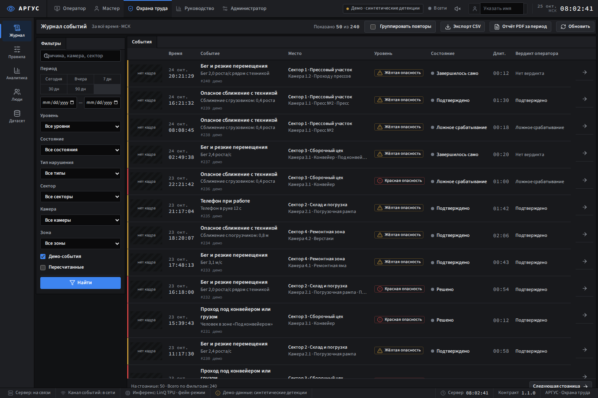
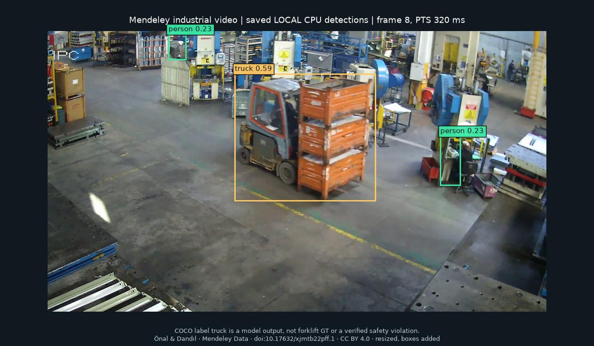
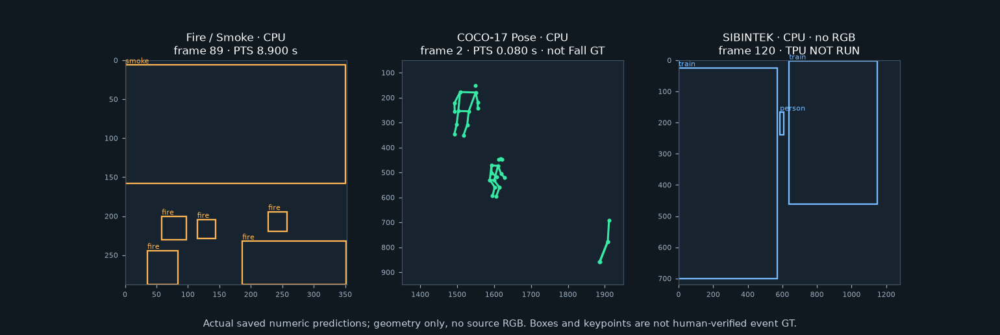
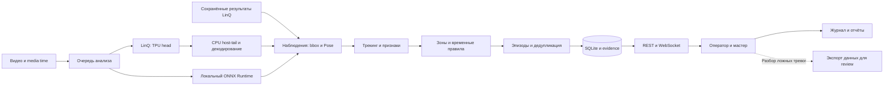

# ARGUS — интеллектуальная промышленная видеоаналитика на LinQ

**От видео производственной камеры — к событию, доказательству и действию оператора.**

Argus соединяет компьютерное зрение, трекинг, временные правила безопасности и рабочее место оператора. Модель сообщает, что видно в кадре; правила учитывают движение, зону и длительность; интерфейс помогает подтвердить событие, передать его мастеру и сохранить результат в журнале.

Проект команды MOSPROM-2026, 23–25 октября 2026 года. Программный пакет и CLI называются `safewatch`. Это инженерный прототип: подтверждённые запуски LinQ, локальные эксперименты и неподтверждённые сценарии ниже имеют разные статусы.

> **Версия отчёта:** приложение — `main` на [`4486106`](https://github.com/MarkHub75/msk-prom2026-mark/commit/4486106153f2a80b64a9b74719d8a75fd827a9d4); ML-ветка — [`d387f86`](https://github.com/MarkHub75/msk-prom2026-mark/tree/d387f868d30f20636db352f9519501262a9816a5). Результат в ML-ветке не означает, что модель включена в финальный профиль приложения.

## 1. Проверить решение за несколько минут

| Материал | Что можно проверить |
|---|---|
| [Быстрый запуск](#quick-start) | Docker или локальный сервер без приватного LinQ-доступа |
| [Демонстрационный релиз](https://github.com/MarkHub75/msk-prom2026-mark/releases/tag/demo-argus-real) | Видео Mendeley и сохранённые результаты LinQ; основной архив `argus-real-v2.zip` |
| [Три маршрута демонстрации](#demos) | Backend, наблюдаемые результаты и ограничения |
| [Требования кейса](#requirements) · [Критерии жюри](#jury) | Карта реализации и доказательств |
| [Официальный кейс, 20 страниц][case] | Постановка, восемь направлений, требования и критерии |
| [Спецификация](tech.md) · [API](contract/openapi.json) · [ML-интеграция](docs/ML_INTEGRATION.md) | Устройство продукта и контракты |
| [ML-handoff][ml-handoff] · [Реестр моделей][model-status] | Принятые и отклонённые кандидаты |
| [Материалы презентации](https://github.com/MarkHub75/msk-prom2026-mark/tree/codex/argus-final-presentation/presentations/final-argus) | Отдельная ветка с каркасом презентации, не окончательно согласованные слайды |

Локальный показ воспроизводим без внешнего стенда. Адрес живой демонстрации согласует Марк; публичный HTTPS/WS этим аудитом не проверен. Большие видео, веса и закрытые материалы работников распространяются отдельно от исходников и этого README.

## 2. Проблема: камеры есть, внимания на все камеры недостаточно

Официальный кейс описывает промышленную площадку, где опасное действие нужно заметить до того, как видеозапись станет материалом расследования. Оператору трудно непрерывно контролировать несколько потоков и одинаково реагировать на короткие эпизоды в течение смены. Службе охраны труда нужны история и повторяющиеся риски; мастеру — конкретное место и понятное действие. [Кейс, стр. 1–3, 7, 9–12][case].

Argus выделяет кандидатов в опасные ситуации и прикладывает проверяемое evidence. Решение о реакции остаётся у ответственного сотрудника. Уверенность детектора сама по себе не доказывает нарушение, травму или потерю сознания. Неподтверждённую статистику аварий и гарантированный процент их сокращения мы не используем.

## 3. Идея: наблюдение отделено от правила

```text
Видео → детекции и позы → треки → признаки движения и контекста
      → временное правило → эпизод → evidence → оповещение → журнал
```

Обнаруженный телефон ещё не означает его использование, а человек рядом с локомотивом — опасное сближение. Нужны привязка объекта к человеку, движение техники, область сцены и устойчивость наблюдения во времени.

Разделение моделей и правил позволяет расширять [model registry](config/models.yaml), сохраняя API событий и операторский процесс. Подключение требует проверки семантики классов, выходных тензоров и качества: запись в YAML не является приёмкой модели. Реализация: [pipeline](src/safewatch/analysis/pipeline.py), [rules](src/safewatch/rules), [ML-контракт](docs/ML_INTEGRATION.md).

## 4. История разработки: 23–25 октября

| Этап | Решение | Результат |
|---|---|---|
| 23 октября: постановка и baseline | Разделить объекты и временные нарушения | Расширяемый pipeline и приоритетные проверки вместо обещания одинаковой готовности всех сценариев |
| 23–24 октября: инфраструктура | ONNX, PTQ, компиляция TPU, CPU-декодирование и контракты | Подготовка, симуляция, устройство и качество стали отдельными этапами допуска |
| 24 октября: данные и обучение | Проверять домен, GT, права и splits; обучить кандидатов Phone/PPE/Fall/Forklift | Улучшения на source validation не всегда выдерживали промышленный перенос |
| 24–25 октября: интеграция | Соединить backend, интерфейс, правила и evidence | Полный путь «оператор → мастер → журнал» в `main` |
| 25 октября: финальный показ | Исправить повторы, передачу события и спорную зону у пресса | Приоритет воспроизводимости и качества над количеством checkpoints |

Основания: [история коммитов](https://github.com/MarkHub75/msk-prom2026-mark/commits/main/), [progress.md](progress.md), [этап 1](docs/handoff/upgrade-v3-stage-1.md), [этап 2](docs/handoff/upgrade-v3-stage-2.md), [ML-handoff][ml-handoff]. Внутренние номера экспериментов S24/S29 не обозначают официальные сценарии S01–S08.

## 5. Что реализовано

| Возможность | Реализация и границы |
|---|---|
| Видео | Импорт файлов, очередь, кадры с media time, replay; непрерывный RTSP этим релизом не подтверждён |
| Распознавание | Детектор, Pose, дополнительные модели, связь наблюдений с треками, частота анализа |
| Контекст | Зоны, линии, классы техники, временные условия и приоритеты правил |
| Оповещения | Тип, камера, время, evidence; REST/WS; состояние доставки webhook |
| Дедупликация | Эпизодная логика; финальное исправление отключает бесконечный цикл демо по умолчанию |
| Работа с событием | Подтверждение/отклонение, взятие мастером, завершение и история |
| Журнал | Фильтры, CSV, PDF смены, статистика; демонстрационный seed синтетический |
| Обратная связь | Сбор и экспорт ложных тревог; автоматическое переобучение и верификация GT не заявляются |

Доказательства: [API 1.1.0](contract/openapi.json), [WS-схема](contract/ws.schema.json), [backend](src/safewatch), [frontend](frontend/README.md), [финальные исправления](docs/handoff/upgrade-v3-stage-2.md).

## 6. Интерфейс: от тревоги к решению



*Реальный интерфейс приложения. На скриншоте синтетический seed для проверки журнала, не результат распознавания и не статистика предприятия.*



*Исходный Mendeley-кадр 8, PTS 320 мс; наложены реальные сохранённые LOCAL CPU bbox с display threshold 0,20. `truck` — нативное предсказание COCO, не подтверждённый класс forklift и не нарушение. Видео: Önal, Dandıl, DOI 10.17632/xjmtb22pff.1, CC BY 4.0; изменения: уменьшение, рамки и подписи.*

Оператору нужен быстрый переход к кадру и контексту; мастеру — назначение и завершение; специалисту ОТ — фильтры и выгрузка. Production API и WS используют текущий origin. `?review=real` исключает фронтовую демонстрационную подмену. Исторические [скриншоты frontend](frontend/README.md) относятся к mock-режиму, а не к LinQ.

<a id="demos"></a>
## 7. Три демонстрационных маршрута

| Маршрут | Что показываем | Фактический статус |
|---|---|---|
| **Mendeley → LinQ → оператор → мастер → журнал** | Настоящее видео мастерской, сохранённые детекции/Pose, правила, evidence, действия пользователя | Публичный `argus-real-v2`: четыре видео. Replay не выполняет новые TPU-запросы. Пресс ранее принимался за транспорт, поэтому контекст критичен |
| **SIBINTEK: человек и локомотив в тёмном депо** | Движение состава, люди, сложный свет и контрольная сцена | Новый пакет — **LOCAL CPU**, новых TPU-кадров **0**. На контроле есть спорные тревоги; это интеграционная демонстрация, не подтверждение опасности |
| **Fire/Smoke: позитив и фары как сложный негатив** | Дополнительная модель, временное правило и evidence | CPU: 293 кадра позитивного видео, 155 кадров контроля. На контроле 26 кадров с fire-score ≥ 0,35. Модель экспериментальная |

Первый маршрут доступен в [релизе](https://github.com/MarkHub75/msk-prom2026-mark/releases/tag/demo-argus-real); третий — в [ML-интеграции](docs/ML_INTEGRATION.md) и [ML-handoff][ml-handoff]. SIBINTEK передаётся в закрытом контуре: публичные права на видео не установлены. Пути и SHA — в [реестре доказательств](#evidence-ledger).

Это три проверочных маршрута, а не три независимо подтверждённых класса нарушений. Проверка S07 на URFall в текущем Argus не дала положительного события; отдельные исследовательские метрики приведены ниже.



*Визуализация численных выходов, не иллюстрация с выдуманными bbox: Fire/Smoke — frame 89, PTS 8,900 с; Pose — frame 2, PTS 0,080 с; SIBINTEK — frame 120. Все три — CPU. Для SIBINTEK исходный RGB не опубликован; для Pose показаны точки confidence ≥ 0,30. Pose-скелет не доказывает падение, а рамки — событие. Закрытый SIBINTEK MP4 доступен только в разрешённом командном пакете.*

## 8. Восемь официальных направлений и дополнительные PPE

Формулировки — по стр. 4 [кейса][case]. **S08 — дополнительный сценарий официального списка. Helmet/Respirator — дополнительные функции команды.**

| Scenario | Что требуется | Модели / классы | Реальный статус | Доказательство / демо | Ограничения |
|---|---|---|---|---|---|
| **S01** | Бег по цеху, резкие перемещения в зоне работы техники | person, треки, скорость, Pose | Правило есть; перенос Running не принят | [rules](src/safewatch/rules), [Behavior][behavior] | Ракурс, перспектива, пропуски людей; нет независимой промышленной точности |
| **S02** | Опасное сближение человека с движущимися механизмами или транспортом | person, train/truck/forklift, зоны | Основной интеграционный маршрут | Mendeley-пакет, SIBINTEK-контроль | Присутствие не нарушение; ложные vehicle на станках; расстояния не в метрах |
| **S03** | Использование мобильного телефона при работе с оборудованием или при перемещении по цеху | cell phone, person, Pose | Правило есть; улучшенный Phone экспериментальный | FPI benchmark, [ML-handoff][ml-handoff] | phone-box не доказывает использование; face не person; нет event-GT |
| **S04** | Курение или использование открытого огня вне отведённых мест | fire, smoke, cigarette | Fire/Smoke проверен локально; smoking не квалифицирован | CPU-позитив и контроль фар | Дым — вспомогательный сигнал; фары дают FP; нового TPU нет |
| **S05** | Перелезание через ограждения, пролезание под конвейером или подвешенным грузом | person, Pose, линии/ROI, suspended_load | Геометрический прототип | [rules](src/safewatch/rules) | Линия не доказывает перелезание; qualified suspended_load-модели нет |
| **S06** | Работа на высоте без использования страховочной привязи | person, harness/no_harness, зона | Правило подготовлено, модель/GT недостаточны | [ML-интеграция](docs/ML_INTEGRATION.md) | Невидимая привязь не означает её отсутствие |
| **S07** | Падение человека, неподвижное лежание на полу, признаки потери сознания | person, COCO-17, неподвижность | Код и source-эксперименты; промышленная приёмка не пройдена | [Behavior][behavior], GMD/URFall ниже | Clip-F1 не online event-F1; видео не подтверждает потерю сознания |
| **S08** | Переноска груза с нарушением правил **(дополнительный)** | person, Pose, груз | Каркас | [load_carrying.py](src/safewatch/rules/load_carrying.py) | Нет принятой модели, полного GT и продемонстрированного event-контроля |
| **PPE** | Каска / отсутствие каски; респиратор | helmet, no_helmet, respirator | Helmet baseline сохранён; respirator не квалифицирован | [Detection][detection] | helmet-only не no_helmet; mask не respirator; перекрытая голова — UNKNOWN |

## 9. Архитектура



CPU, LinQ и replay — разные режимы исполнения, а не взаимозаменяемые доказательства. Нельзя незаметно заменить TPU на GPU и сохранить прежнюю маркировку. Между моделью и правилами передаются координаты исходного кадра, confidence, время и идентичность модели. Пробел наблюдений не считается безопасным кадром. [Контракт LinQ](docs/linq/LINQ_CONTRACT.md), [ML-интеграция](docs/ML_INTEGRATION.md), [код](src/safewatch).

## 10. Полный ML → LinQ → Argus pipeline

1. **Модель и данные.** Фиксируем checkpoint, class map, split и права. Основной COCO-детектор сохраняет свою 80-классовую роль; двухклассовая экспериментальная модель не заменяет его автоматически.
2. **Подготовка.** Экспортируем совместимый ONNX, проверяем preprocessing, формы выходов и численную паритетность. Выполняем PTQ и проверяем регрессию на контрольных данных.
3. **Компиляция.** Получаем TPU-программу под согласованный runtime ABI. Compiler PASS подтверждает сборку, но не инференс на устройстве.
4. **Исполнение.** Авторизованный runtime выполняет TPU-часть; CPU host-tail завершает граф и декодирование. Сохраняем идентификаторы запросов, версии и численные тензоры.
5. **Наблюдения.** Возвращаем bbox/Pose к исходным координатам и исходному media time. Нативный class ID имеет смысл только вместе с class map своей модели.
6. **События.** Argus связывает треки, геометрию зон и временные условия, сохраняет эпизод и evidence; затем отправляет обновление интерфейсу.

**Почему появился Split-Pose.** У исходного смешанного выхода Pose квантование ухудшало confidence ключевых точек. Команда разделила выходы и оставила чувствительную часть декодирования на CPU. Вариант `split_pose_v8` потребовал собственного проверенного host-tail; четыре его выхода нельзя механически подставить вместо трёх выходов другого Pose-профиля. Это исправление интерфейса и численного поведения, не автоматическое улучшение распознавания падений. [Detection][detection], [ML-evidence][ml-evidence].

**Семантика техники.** Класс `forklift` передаётся дополнительной моделью и должен быть явно включён в `vehicle_classes`; `train` остаётся поездом/локомотивом. Нельзя переименовать станок в forklift или нативный SIBINTEK ID `0` в COCO `person`. Отсутствие helmet/harness-аннотации не создаёт отрицательный класс.

## 11. Данные: зачем исследовали и что действительно получили

Работа с данными была частью проверки гипотез, а не соревнованием по числу скачанных архивов. Для быстрых нейросетевых экспериментов пригодны размеченные изображения; для события нужны видео, время, участники и полнота GT. Эти два типа данных не подменяют друг друга.

| Dataset | Domain / объём проверенного среза | Разметка | Использование | Ограничения и права |
|---|---|---|---|---|
| **Mendeley industrial videos** | Реальные производственные сцены; публичное демо v2 — 4 видео | Детекции, полученные моделью; исчерпывающий hazard-GT не установлен | Основной видеопуть LinQ → Argus | Önal, Dandıl; DOI [10.17632/xjmtb22pff.1](https://doi.org/10.17632/xjmtb22pff.1), CC BY 4.0; сохранять attribution |
| **GMD** | 160 видео ADL/Fall; train 123, DEV 37 | Метка целого ролика | Source-validation Fall/RGB/Pose | CC BY 4.0 по источнику; независимость актёров/камер не доказана, не промышленный event-test |
| **URFall** | Лабораторный контроль: 20 видео, 10 Fall / 10 ADL; 225 наблюдений при 2 FPS | Source event-разметка и pose-наблюдения | Проверка временной логики | Постановочный домен; нельзя делать медицинские выводы или гарантировать промышленный recall |
| **CAVIAR** | CCTV ходьбы/бега | Треки и действия источника | Проверка переноса Running | Мелкие люди, пропуски детекции; классификатор не исправляет отсутствующее наблюдение |
| **PREWID / PPE / SHEL** | Реальные изображения СИЗ; контроль helmet/no_helmet | Bbox, неодинаковая полнота классов | Проверки переноса PPE и PTQ | Права и полнота проверяются по конкретному пакету; source-overlap ограничивает независимость |
| **Construction PPE** | 1 117 train / 128 val в переданном пакете | 11 классов источника, YOLO | Исследовательский fine-tuning | Source-аннотации, не HUMAN_VERIFIED; перенос нового checkpoint не прошёл safety-gate |
| **FPI Phone/Face** | 955 train / 127 val | phone/face bbox; в val 67 phone-boxes | Phone fine-tuning и парное сравнение | face не person; неполные негативы; source val использовалась для выбора модели |
| **FIRESENSE / D-Fire** | Исследованы видео и fire/smoke-изображения | Разные source-форматы | Поиск позитивов и сложных негативов | Не каждый кандидат допущен: для D-Fire ограничения прав не были окончательно сняты; общий статус «всё разрешено» не присваивался |
| **Roboflow, 5 пользовательских ZIP** | Аудит 9 190 изображений / 28 464 объектов | Bbox и часть polygon → bbox | Christ fork/person projection: 232 train / 55 DEV; warehouse — TRAIN_ONLY с внешним DEV | Christ — CC BY 4.0, warehouse v7 — MIT по издателю; остальные три NEEDS_FIX. Дубли, неполные метки и общее происхождение ограничивают независимость |
| **NVIDIA SDG Warehouse — SYNTHETIC** | Ограниченная выборка: 2 run, 2 камеры, 4 RGB-клипа | Structured GT; часть bbox отсутствует/невалидна | Отдельный синтетический research-пакет | OpenMDW-1.1; train/DEV разделены по run, все камеры run вместе. Не независимый реальный test |
| **SIBINTEK** | 3 оригинала, 25 292 кадра; dataset_v2: 3 000 изображений | 8 646 записей объектов; 8 644 bbox и 2 polygon | Промышленное demo/dev, классы людей и train | Старые train/val/test указывали на одну выборку; 15 точных дублирующихся пар; видео-GT не зарегистрирован; публичные права неизвестны |

Для SIBINTEK классы `person_blue/gray/orange/red/white` можно проецировать в `person` с сохранением происхождения. Цвет одежды не track ID и не СИЗ. Класс `nonane` не переименован глобально: часть маленьких/перекрытых объектов осталась UNKNOWN. 104 пустых файла аннотаций не считаются проверенными отрицательными кадрами.

Pathfinder, Mendeley, GMD, URFall, CAVIAR, PREWID, FIRESENSE, Roboflow, NVIDIA и SIBINTEK дали разные результаты: от реально использованных файлов до кандидатов, остановленных лицензией или качеством. Исследовательская рекомендация не считается выполненным скачиванием или обучением. Командные manifests хранятся отдельно от Git; [реестр ниже](#evidence-ledger) показывает, какие проверки доступны только в командном архиве.

**Source leakage.** Соседние кадры, камеры одного run, разные augmentations и изображения из pretraining не должны попадать по разные стороны независимого теста. Для SIBINTEK все материалы остаются одной DEV-семьёй. Для Roboflow random split без camera/session identity не объявляется source-safe независимым тестом. Source train/val можно использовать для исследовательского обучения с явными ограничениями, но не для доказательства промышленной точности.

## 12. Модели и эксперименты: принимали по качеству

В таблице сравниваются только сопоставимые пары внутри своей задачи. Значения разных строк нельзя складывать в общую «точность Argus».

| Model | Dataset | Metric | Baseline | Candidate | Result | Decision |
|---|---|---|---|---|---|---|
| Fall: RGB + Pose prior | GMD, 37 DEV clips, 20 ADL / 17 Fall | Clip macro-F1 | 0,729532 | 0,783626 | Ложные Fall на ADL 7 → 5; Fall recall 14/17 не изменился | Принят только как source-validation research; не online TPU-модель |
| Phone fine-tuning | FPI, 127 val images / 67 phone-boxes | Detection F1, conf 0,30, NMS 0,45, match IoU 0,50 | 0,359551 | 0,765625 | TP 16 → 49; FP 6 → 12; FN 51 → 18 | Экспериментальный дополнительный checkpoint; event-ready не объявлен |
| Construction PPE fine-tuning | Внешний matched no_helmet-контроль | Число сопоставленных TP | 23 | 4 | Source-метрики не сохранились при переносе | Отклонён как замена стабильной модели |
| Helmet PTQ-кандидат | Тот же quality-v3 контроль | Macro-F1 | 0,741682 | 0,735185 | Ухудшение, дополнительный helmet FP | Отклонён; новая компиляция не равна улучшению |
| Fall policy: partial-torso candidate | URFall, 20 clips (10 Fall / 10 ADL), 225 наблюдений, 2 FPS | Event F1 | 0,181818 | 0,181818 | TP 1, FP 0, FN 9 у обоих | Нет выигрыша; опция выключена, не принята |
| Forklift FitA | 55 source-DEV images / 8 forklift-GT | Detection F1 | 0,625000 | 0,736842 | Лучше на source; локомотивы и станки дают ошибочные предложения | Не принят как промышленная замена; source-overlap с pretraining |
| Running transfer | CCTV / CAVIAR source-проверки | Независимый production event-F1 | Не измерен | Не измерен | Пропуски людей и domain shift; подтверждённого выигрыша нет | Кандидаты не приняты; правило остаётся прототипом |

Первичные источники: [Detection][detection], [Behavior][behavior], [ML-handoff][ml-handoff], [финальный статус][model-status]; парные GMD/FPI-отчёты и SHA указаны в [реестре](#evidence-ledger).

Для Helmet PTQ использовались confidence 0,25, class-aware NMS 0,45 и match IoU 0,50 на тех же 52 quality-v3 изображениях с учётом class completeness. Forklift FitA сравнивается со своим task initializer, не с произвольно выбранной HF-моделью: conf 0,25, TP/FP/FN 5/3/3 → 7/4/1, 8 source-GT forklift-boxes. Существующее совпадение фотографий с pretraining HF ограничивает независимость этого набора. URFall использует source-reference bounded onset, временной допуск 5 000 мс, one-to-one matching, исключение UNKNOWN и left-censored GT; это не точная actor-owned промышленная разметка. [Протокол temporal evaluation](https://github.com/MarkHub75/msk-prom2026-mark/blob/d387f868d30f20636db352f9519501262a9816a5/ml/quality/temporal/evaluation.py).

**Phone — полезный, но ограниченный выигрыш.** Precision вырос с 0,727273 до 0,803279, recall — с 0,238806 до 0,731343. Число FP при этом увеличилось вдвое. Проверка четырёх видео дала 4 617 CUDA-вызовов на 1 539 кадрах для трёх моделей, но телефонных эпизодов в Argus не появилось. Книги и пульты остаются трудными похожими предметами; валидируемое «телефон в руке» требует связи с человеком и event-GT. Это не повод менять правило, чтобы искусственно получить событие. [ML-handoff][ml-handoff].

**Fall — проверка гипотезы, не готовый монитор травм.** GMD-кандидат использует последовательность целого ролика и некаузальный контекст. Его лучший принятый epoch сохранил recall падений; более высокий macro-F1 другого epoch был отвергнут из-за потери одного fall. Лабораторный classification benchmark не заменяет потоковую проверку падения и неподвижности.

**PPE — критична цена FN.** Рост усреднённой метрики не компенсирует потерю recall класса no_helmet. При PTQ отдельно проверяли эту регрессию. Stable Helmet/Pose/COCO сохранены, а экспериментальные Phone, Fire и Forklift не получили общий статус production-ready. [Реестр решений][model-status].

## 13. Как читать метрики

**Detection precision** — доля корректно сопоставленных bbox среди предсказаний при заданных confidence/IoU. **Event precision** — доля правильно найденных временных эпизодов. Для event-оценки нужны интервал, участники, правило matching, временной допуск и дедупликация. Эти метрики имеют разные единицы наблюдения.

Лабораторный F1 на падениях не доказывает промышленную надёжность: меняются камера, дистанция, одежда, перекрытия, действия и частота анализа. Одни и те же train/test-кадры дают оценку запоминания. Пустая аннотация не является отрицательным GT, пока не доказана полнота разметки. UNKNOWN и ignore regions должны исключаться из соответствующей оценки.

False alarms per hour имеет смысл только на достаточно длинном и полноценно размеченном отрицательном видео. В этом README такая независимая промышленная цифра **не заявляется**. `safewatch eval` поддерживает отчёт метрик, но его запуск на учебных или неполных метках не создаёт достоверный production benchmark. [Пример протокола](config/eval.example.yaml).

## 14. Производительность: что именно измерено

| Model / backend | Input | Frames | Latency / FPS | Measurement provenance |
|---|---|---|---|---|
| Detector / LinQ worker | Диагностический COCO-монтаж, 640 | 400 обработано | 20,95 FPS; RTT p50 328,47 мс; inflight 8 | [Сохранённый summary](results/linq_smoke/synthetic_coco_40x1s_mosprom_det640_cut_ap9999_b1_o1_h1m_s1.summary.json), wall 19,09 с |
| Pose / LinQ worker | Тот же монтаж, 640, step 2 | 200 из 400 | 19,61 FPS; RTT p50 181,06 мс; inflight 4 | [Сохранённый summary](results/linq_smoke/synthetic_coco_40x1s_mosprom_pose640_cut_ap9999_b1_o1_h1m_s2.summary.json), wall 10,20 с |
| Detector / LinQ worker, второй граф | Тот же монтаж, 640, step 2 | 200 из 400 | 19,52 FPS; RTT p50 182,22 мс; inflight 4 | [Сохранённый summary](results/linq_smoke/synthetic_coco_40x1s_mosprom_yolov8n_640_op13_o1_cut_b1_o1_h1m_s2.summary.json), wall 10,25 с |
| Детектор + Pose / реальный industrial build | Два Mendeley-видео, step 2 | 598 model-frame результатов, не 598 уникальных кадров | В отчёте сборки 9,8–10,6 FPS на worker; build 70,7 с | Запись R32 в [progress.md](progress.md); 299 уникальных source frames, результаты двух моделей |
| Исторические Matvey TPU-вызовы | Pose/Helmet, реальные выбранные кадры | 15 status=0 вызовов / 13 уникальных кадров | Wall p50 10,630 с на вызов, включая транспорт; device-only latency не измерена | [Коррелированное ML-evidence][ml-evidence]; это другой путь исполнения |

Имена `synthetic_coco` обозначают диагностический монтаж изображений, не промышленную validation и не NVIDIA Warehouse. Throughput при нескольких inflight-запросах нельзя получать как обратную величину одного RTT. Загрузка видео, очередь, сеть, polling, TPU, host-tail и postprocessing вносят разные задержки. Ни одна строка не является гарантией числа одновременно обслуживаемых камер.

## 15. Реальный LinQ: граница подтверждённого

**Подтверждено:** в репозитории сохранены summary аппаратного сервиса; основной демопакет содержит заранее полученные результаты LinQ. Отдельная ML-линия сохранила 15 успешных коррелированных TPU-вызовов с численными выходами, идентичностью запросов и проверкой ABI; повторное декодирование 15 сохранённых outputs совпало побитово. [ML-evidence][ml-evidence], [LinQ-контракт](docs/linq/LINQ_CONTRACT.md), [results](results/linq_smoke).

**Это не означает:** положительное распознавание каждого нужного объекта, независимую event-точность, live TPU во время replay или перенос любого нового checkpoint. Два исторических industrial Helmet-выхода декодировались без детекций. Смешанный replay TPU-наблюдений с GPU COCO не является полностью TPU pipeline.

**Не подтверждено в новом SIBINTEK-пакете:** свежий TPU-прогон. Подготовлены исходники и ограниченное задание; фактическое выполнение остановлено отсутствием разрешённого runtime-доступа. Новых TPU-кадров 0. Чужая прошлогодняя демонстрация и старые метрики не использовались как доказательство нынешнего Argus.

**Отдельный финальный NVIDIA-пакет — SYNTHETIC, GPU.** Две 10-секундные сцены по 300 кадров сопоставлены с исходными RGB/PTS. Из 600 GPU-наблюдений 580 получены заново, 20 повторно использованы после проверки camera/frame/RGB/checkpoint. Offline Argus replay дал 1 proximity-эпизод на run25 и 0 на run10; это ещё не подтверждённые события в API Марка и не event-GT. Native class map `0=forklift, 1=person`, профиль отдельный, stable не заменяет; TPU READY не присвоен. [Точный handoff](https://github.com/MarkHub75/msk-prom2026-mark/blob/d387f868d30f20636db352f9519501262a9816a5/docs/handoffs/NVIDIA_S02_NIGHTSHIFT_HANDOFF_20261025.md).

Live LinQ требует предоставленного организаторами доступа и совпадения runtime/TPU/host-tail. Обычному проверяющему он не нужен для воспроизведения публичного кэша. Секреты, notebook state и закрытые сетевые настройки в README не публикуются.

## 16. Ошибки, ограничения и инженерные уроки

| Наблюдение | Почему это важно | Принятое решение |
|---|---|---|
| Fire на фарах и ярком свете | Высокий score не гарантирует огонь | Отдельный негативный контроль, experimental-статус, без заявления независимой точности |
| Forklift на станках и локомотиве | Source-validation не переносится автоматически | Не заменять stable-детектор; сохранять class semantics и проверять motion/context |
| Падение не подтверждено текущим Argus на UR06 | Offline classifier и online event engine — разные продукты | Раздельные benchmark и честный статус S07 |
| Новое PPE ухудшило no_helmet | Усреднение скрывает опасные FN | Классовый safety-gate и отклонение checkpoint |
| Повтор тревоги после нового цикла ролика | Replay может выглядеть как многократный инцидент | One-shot по умолчанию и отдельные regression-тесты |
| Человек у пресса попал в неверную danger-зону | Конфигурация сцены влияет не меньше модели | Уточнение назначения зоны; свежий импорт старого пакета проверять отдельно |
| Маленькие/перекрытые объекты и паузы наблюдений | Отсутствие box не доказывает безопасность | UNKNOWN, ограничения полноты GT, запрет создавать негативы из пустых файлов |

Состояние модели проверяется на конкретном consumer: удачный ONNX, CPU parity, PTQ simulation, actual TPU completion и Argus event — последовательные разные проверки. Инженерная зрелость здесь — возможность сохранить неудачный эксперимент, объяснить отказ и воспроизвести решение. [Финальный статус моделей][model-status], [этап 2](docs/handoff/upgrade-v3-stage-2.md).

## 17. Пользователи и эксплуатационный сценарий

| Роль | Задача | Путь в Argus |
|---|---|---|
| Оператор | Быстро оценить тревогу и контекст | Камера → карточка → evidence → подтвердить / отклонить |
| Мастер | Принять ответственность за реакцию | Получить переданное событие → взять в работу → завершить |
| Специалист ОТ | Разобрать повторяемость, подготовить отчёт | Журнал, фильтры, CSV/PDF, аналитика и ложные тревоги |
| Руководитель | Понять распределение рисков | Сводная статистика, без подмены оценки безопасности числами demo seed |
| Администратор / IT | Настроить камеры, модели и правила | Конфигурация, зоны, системный экран и диагностика |

Основания: [кейс, стр. 9–12][case], [интерфейс](frontend/README.md), [контракт ролей](contract/openapi.json). Работники и водители — участники наблюдаемых процессов, не дополнительные придуманные аккаунты продукта. В текущем прототипе роли передаются через `X-Role`, WS — через `/ws?role=...`; **аутентификации нет**. Для промышленного внедрения нужны IAM, контроль доступа и политика работы с видео.

## 18. Аналоги и конкретные отличия Argus

Промышленная видеоаналитика уже существует. Мы не считаем стандартные детекторы, зоны или трекинг собственным изобретением.

| Решение | Подтверждённое направление | Отличие задачи Argus |
|---|---|---|
| [Intenseye](https://www.intenseye.com/) | EHS-видеоаналитика, PPE и риски взаимодействия людей с техникой | Прототип под конкретный кейс MOSPROM, интеграция LinQ и проверяемая история допуска моделей |
| [Macroscop](https://macroscop.com/) | VMS и интеллектуальные модули, включая промышленную безопасность | Явное разделение наблюдений, временных правил и операторского эпизода; открытая реализация нашего workflow |
| [Frigate](https://docs.frigate.video/) | NVR с object detection, zones и событиями | Ориентация Argus на производственные правила и передачу «оператор → мастер», а не на универсальный NVR |

Это сравнение назначения по официальным страницам, а не измеренный конкурентный benchmark. Мы не заявляем, что у аналогов отсутствуют функции, которые отдельно не проверяли. Предметная аналитика и UX-гипотезы сохранены в [исследовании кейса](Deep-Research/LinQ-case-analytics-research/report_human_case_analytics.md); исследование является reference, не доказательством выполненного инференса.

Конкретная инженерная комбинация Argus: model registry, российский TPU с CPU host-tail, временная событийная дедупликация, зоны, evidence, журнал и экспорт ошибок. Каждая часть имеет собственный контракт и может проверяться отдельно. Контур обратной связи пока заканчивается экспортом; замкнутый автоматический retraining не реализован.

## 19. Внедрение: где эффект, где затраты

**Небольшой участок.** Начать с одной камеры и одного правила, согласовать зоны с ответственным, собрать длительный отрицательный контроль и проверить цепочку реагирования. Использовать существующую камеру можно, если её качество, ракурс и режим доступа достаточны; это требует обследования.

**Несколько камер.** Нужны планирование очереди, доступная сеть, сервер приложения/хранилище, вычислительный backend и контроль задержки. Число камер выбирают по измеренному end-to-end времени и целевой частоте анализа, а не по одному FPS модели. Для LinQ необходимы runtime-доступ и совместимый набор артефактов. Для локального ONNX — вычислительный ресурс и проверенные weights.

Эксплуатационные расходы: вычисления, хранение evidence, сеть, обслуживание моделей, настройка зон, разбор ложных тревог и информационная безопасность. Практическая польза — направлять внимание оператора на кандидаты событий и сохранять контекст реакции вместо постоянного одинаково интенсивного просмотра всех камер. Финансовая экономия и снижение аварий на фиксированный процент **не измерены**.

**Калькулятор внедрения действительно реализован:** [calculator.py](src/safewatch/calculator.py), API `/api/calculator/defaults`, `/api/calculator/rollout`, `/api/calculator/scale`. Входы: число камер/цехов, операторы и смены, частота инцидентов, стоимость простоя и других последствий. Отдельные редактируемые допущения задают цену/производительность ускорителя, сервер, интеграцию, обслуживание и ожидаемое снижение риска. Выходы: количество оборудования, CAPEX/OPEX, расчётная экономия и срок окупаемости; если экономия не превышает OPEX, срок возвращается как `null`.

Это сценарный расчёт, не подтверждённый бизнес-результат. Параметры снижения риска и цена LinQ не становятся измеренными фактами от наличия поля в интерфейсе. Без согласованной сметы и независимого пилота окупаемость не доказана. [Спецификация](tech.md), [описание допущений](docs/ECONOMICS_SOURCES.md), [аналитика кейса](Deep-Research/LinQ-case-analytics-research/report_human_case_analytics.md).

## 20. Технологии и структура репозитория

| Слой | Стек |
|---|---|
| Backend | Python 3.12, FastAPI, SQLite, REST, WebSocket |
| ML | YOLO/Ultralytics, ONNX, ONNX Runtime, OpenCV; PTQ/TPU-подготовка и согласованный CPU host-tail |
| UI | React 18, TypeScript, Vite, Lucide; production bundle обслуживается приложением |
| Развёртывание | uv и lockfile, Node 24, Docker Compose; модели и видео отдельно от исходников |
| Проверки | pytest, Ruff, type checks, contract checks, frontend gate |

```text
src/safewatch/        backend, pipeline, tracking, rules, events, evidence
frontend/            интерфейс и его инструкции
contract/            OpenAPI, WebSocket schemas и examples
config/              профили, registry моделей, пример eval-разметки
models/              mount point / метаданные; наличие модели проверяется отдельно
docs/                интеграция, LinQ, deployment и handoffs
results/linq_smoke/   сохранённые summaries и отчёты компиляции
tests/               программные regression и contract checks
Deep-Research/       исторические исследования и официальный кейс
data/                локальные runtime-данные и демопакеты вне коммита README
```

Веса, ONNX/TPU-программы и source video не требуется хранить в Git. Исследовательские рекомендации читаются вместе с ограничениями, а запуск модели — с конкретным manifest и checksum.

<a id="quick-start"></a>
## 21. Quick Start: локальная проверка без приватного LinQ

### Docker — основной путь

Нужны Docker Desktop с Linux containers или Docker Engine, **Compose 2.24+**, свободный порт 8000 и запас места для образа/демо. Python и Node на хосте не требуются.

```bash
git clone https://github.com/MarkHub75/msk-prom2026-mark.git
cd msk-prom2026-mark
```

Скачайте [argus-real-v2.zip](https://github.com/MarkHub75/msk-prom2026-mark/releases/download/demo-argus-real/argus-real-v2.zip) из публичного релиза и распакуйте **в `data/demo/`**. Ожидается:

```text
data/demo/argus-real-v2/manifest.json
data/demo/argus-real-v2/videos/
data/demo/argus-real-v2/artifacts/
```

Резерв: [argus-real.zip](https://github.com/MarkHub75/msk-prom2026-mark/releases/download/demo-argus-real/argus-real.zip), тот же каталог распаковки; путь профиля тогда `data/demo/argus-real`.

При первом запуске скопируйте `config/docker.example.yaml` в `config/user.yaml` в UTF-8 без BOM. **Существующий свой конфиг не перезаписывайте.** Основной профиль:

```yaml
data_dir: data/app
server:
  static_dir: frontend/dist
demo:
  pack: data/demo/argus-real-v2
  autoload: true
pipeline:
  target_analysis_fps: 12
  detector: det-yolov8n@640-ap9999
  pose: pose-yolov8n@640-ap9999
  extra: []
```

Пути внутри контейнера относятся к `/app`. Windows-путь вида `D:\...` в этот профиль не переносится. Конфигурация сливается `default.yaml → user.example.yaml → user.yaml`. Затем:

```bash
docker compose up -d --build
docker compose ps
docker compose logs --tail 100 safewatch
```

Откройте **http://127.0.0.1:8000/?review=real**. Docker сам собирает production frontend; отдельный Vite, Prism или mock-WS не нужен.

Проверяйте по шагам: `/api/health` → `/api/demo/packs` → выбранный пакет → задачи `done`, `cached: true` → движение видео → карточка/evidence → WS-обновление → «подтверждено оператором → принято мастером → решено → журнал». В `/api/demo/packs` ожидаются `backend: "linq"`, `fake: false`, четыре видео/камеры у v2, два у fallback. Один health-ответ не доказывает готовность всего пути.

`.env` необязателен. Для реального cached-пакета `SAFEWATCH_FAKE=1` не нужен. Если `.env` уже создан, проверьте `INFERENCE_BACKEND=linq` и `SAFEWATCH_FAKE=0`. `LINQ_*` нужны для новой обработки, не для replay; Compose сохраняет явно заданный `LINQ_JUPYTER_URL`.

Runtime хранится в именованном томе `argus-upgrade-v3-stage1-data` (`/app/data/app`). `docker compose restart safewatch` и **`docker compose down` без `-v`** сохраняют данные. Старые host-каталоги не удаляются. Безопасная смена пакета/тома, fallback и HTTPS/WS описаны в [DEPLOY.md](docs/DEPLOY.md). Публичный Tuna-адрес и готовность внешнего доступа уточняют у Марка.

### Разработка без Docker

Нужны Python **3.12**, uv, Node **24**:

```bash
uv sync --locked
npm ci --prefix frontend
npm run build --prefix frontend
uv run --no-sync safewatch serve --seed
```

Не запускайте host и Docker одновременно на 8000 и не выполняйте `uv sync` при работающем host-сервере. Остановка: `uv run --no-sync safewatch stop`. Если демопакет не подключён, seed показывает демонстрационные данные, а не реальные результаты модели. Дополнительные frontend-режимы: [frontend/README.md](frontend/README.md).

## 22. Replay, live LinQ и безопасная демонстрация

**Replay** читает уже сохранённые результаты с backend/provenance исходной обработки. Метка `cached: true` должна оставаться видимой. Разрешённый публичный пакет позволяет пройти пользовательский путь без закрытого аппаратного сервиса.

**Live** выполняет новые запросы на LinQ. Для него нужны доступ организаторов, исходные модели/TPU, matching host-tail и успешная диагностика:

```bash
uv run --no-sync safewatch doctor
```

Отсутствие доступа не компенсируется скрытым CPU/GPU fallback. Приватные адреса и ключи передаются штатным способом владельцу среды, не в Git. [Контракт LinQ](docs/linq/LINQ_CONTRACT.md) и [ML-интеграция](docs/ML_INTEGRATION.md) описывают согласование артефактов; не исполняйте неизвестный notebook целиком.

**Ограничение публичного пакета:** stage 2 исправил код и конфигурацию демонстрационного стенда, но fresh import старого manifest может сохранить спорную зону у пресса. Перед показом проверяйте назначение зоны по [отчёту этапа 2](docs/handoff/upgrade-v3-stage-2.md). Не исправляйте доказательства изменением thresholds ради желаемого события. Звонок мастеру — подписанная заглушка; наличие webhook-кода не доказывает доставку в промышленную систему.

Для чисто синтетической разработки есть `SAFEWATCH_FAKE=1` и frontend mock-режимы. Их результаты маркируются как synthetic и не относятся к аппаратному benchmark.

## 23. Тестирование и воспроизводимость

Основной программный gate:

```bash
uv run poe gate
```

Он включает Ruff, проверки типов, pytest без live-тестов, API/контракт, окончания строк и frontend gate. Отдельно запускаемые аппаратные live-тесты не заменяются этим gate. [Задачи и зависимости](pyproject.toml), [тесты](tests), [frontend](frontend/package.json).

Для event-eval остановите host-сервер, подготовьте реальные expected-интервалы по [примеру](config/eval.example.yaml) и выполните:

```bash
uv run --no-sync safewatch eval config/eval.example.yaml --out data/eval-report
```

Пример содержит путь-заглушку к видео: перед запуском замените его своим существующим файлом и проверенными интервалами. Отчёт поддерживает precision/recall/F1, false alarms/hour и задержку при наличии пригодных данных; отсутствие корректного GT не устраняется запуском команды.

В документационном аудите отдельно собраны production frontend и работающий локальный UI. Документационный коммит не меняет модельный, backend- или тестовый код. Пройденные проверки Markdown, ссылок и media перечислены в сопровождающем handoff; старое число тестов из отчёта агента не выдаётся за новый запуск всей финальной сборки.

Последний опубликованный stage-2 отчёт сообщает **508 backend tests и 125 frontend tests**, отдельные regression до/после исправления и два полных gate. [CI run 40161807881](https://github.com/MarkHub75/msk-prom2026-mark/actions/runs/40161807881) проверен отдельно: `completed / success`, head `a97b3ddc`. Тест настоящего демопакета исполнялся локально у автора отчёта и пропускается в CI при отсутствии архива; CI сам по себе его прохождение не доказывает.

Для воспроизведения ML-сравнения фиксируйте commit, checkpoint SHA, data manifest, source split, backend, input size, cadence, confidence/NMS/match IoU и правила исключения UNKNOWN. Для event matching отдельно фиксируйте temporal tolerance и определение TP/FP. Отсутствующие параметры старого эксперимента не следует восстанавливать догадкой.

<a id="requirements"></a>
## 24. Соответствие официальному кейсу и критериям жюри

### Шесть обязательных возможностей — стр. 13

| Requirement | Implementation | Evidence | Status |
|---|---|---|---|
| Приём данных: видеопотоки и последовательности изображений | Файлы видео, кадры, очередь и воспроизведение; streaming/отдельный image-ingest не заявлены готовыми | [pipeline](src/safewatch/analysis/pipeline.py), [API](contract/openapi.json), [DEPLOY](docs/DEPLOY.md) | **Частично:** рабочий видеопрототип, не полный live ingest |
| Нейросетевое распознавание нарушений | Детекции/Pose плюс временные правила | [Матрица S01–S08](#8-восемь-официальных-направлений-и-дополнительные-ppe), [ML-интеграция](docs/ML_INTEGRATION.md) | **Прототип:** неодинаковая готовность сценариев |
| Оперативное оповещение с кадром/фрагментом, камерой, временем и типом | Карточка, evidence, REST/WS, доставка | [API](contract/openapi.json), [этап 1](docs/handoff/upgrade-v3-stage-1.md) | **Реализовано**, end-to-end demo; производственный SLA не измерен |
| Подавление повторных срабатываний | Эпизоды, cooldown и one-shot demo | [test_one_alarm.py](tests/test_one_alarm.py), [этап 2](docs/handoff/upgrade-v3-stage-2.md) | **Реализовано и regression-проверено** в описанном сценарии |
| Журнал с фильтрацией | Фильтры, статусы, CSV/PDF | [API](contract/openapi.json), [UI](frontend/README.md) | **Реализовано**; seed-аналитика синтетическая |
| Настоящий LinQ-инференс и замеры скорости | Сохранённые аппаратные summaries и коррелированные outputs, cached replay | [results](results/linq_smoke), [ML-evidence][ml-evidence], [§14](#14-производительность-что-именно-измерено) | **Исторически подтверждено** для перечисленных моделей; свежий SIBINTEK TPU не выполнен |

Желательные расширения: зоны/правила, dashboard и подтверждение оператором реализованы в прототипе. Несколько камер есть в replay; одновременная промышленная обработка нескольких live-потоков не аттестована. [Кейс][case], [tech.md](tech.md).

<a id="jury"></a>
### Семь критериев оценки — стр. 19

| Criterion | How Argus addresses it | Evidence link |
|---|---|---|
| **1. Прототип** | Рабочий путь от видео и наблюдений к карточке, мастеру и журналу; границы функций указаны | [Quick Start](#quick-start), [этап 1](docs/handoff/upgrade-v3-stage-1.md), [сценарии](#demos) |
| **2. Решение основной проблемы** | Выделяет кандидатов риска и сохраняет контекст для реакции | [Матрица направлений](#8-восемь-официальных-направлений-и-дополнительные-ppe), [rules](src/safewatch/rules) |
| **3. Разработка и внедрение** | Пилот на ограниченном участке, использование камер, раздельный учёт вычислений/хранения/сопровождения | [Обоснование внедрения](#19-внедрение-где-эффект-где-затраты), [DEPLOY](docs/DEPLOY.md) |
| **4. Новаторские идеи** | Комбинация расширяемого registry, LinQ/host-tail, временных правил, evidence и обратной связи | [Архитектура](#9-архитектура), [pipeline](src/safewatch/analysis/pipeline.py), [ML-контракт](docs/ML_INTEGRATION.md) |
| **5. UI/UX** | Отдельные рабочие задачи оператора, мастера, ОТ и администратора; подтверждение и передача события | [Интерфейс](#6-интерфейс-от-тревоги-к-решению), [frontend](frontend/README.md) |
| **6. Второстепенные проблемы** | История, разбор ложных тревог, отчётность, статистика и зоны | [API](contract/openapi.json), [tech.md](tech.md) |
| **7. Аналитика** | Роли и UX, анализ аналогов, domain shift, права/GT, допуск моделей по переносу | [Пользователи](#17-пользователи-и-эксплуатационный-сценарий), [аналоги](#18-аналоги-и-конкретные-отличия-argus), [эксперименты](#12-модели-и-эксперименты-принимали-по-качеству) |

Это карта доказательств, не самооценка баллов. Веса критериев и формула итогового балла не изобретались.

## 25. Дальнейшее развитие и команда

Сначала — независимый пилот: source-safe реальные видео, полная event-разметка, отрицательные часы, actor/object identity и adjudication человеком. Затем — калибровка зон и движения техники, снижение FP на свете/станках, проверка маленьких объектов и перекрытых голов. Только после этого — расширение покрытия harness, suspended_load и S08.

Следующий аппаратный шаг — разрешённый свежий LinQ-прогон точно тех версий, которые прошли качество, с отдельными device/transport/postprocess/end-to-end замерами. Продуктовый — аутентификация, права, ретенция видео, устойчивый live ingest, мониторинг и нагрузочный тест нескольких камер. Обратная связь оператора должна проходить review, а не автоматически становиться HUMAN_VERIFIED или новым train.

| Участник | Подтверждённая роль |
|---|---|
| **Матвей** | ML/CV, данные, обучение моделей, LinQ-интеграция |
| **Марк** | Капитан, backend, правила и общая продуктовая интеграция |
| **Егор** | Frontend и интерфейс |

Другие имена и роли здесь не добавлены без проверенных данных. Использование стандартных библиотек и исследовательских помощников не меняет авторство исходных моделей, датасетов и стороннего ПО.

<a id="evidence-ledger"></a>
## 26. Источники, лицензии и реестр доказательств

**Первоисточник требований:** [официальный PDF][case], 20 страниц. В рабочем архиве он называется `КЕЙС_LinQ.pdf`, а не `OFFICIAL_LINQ_CASE.pdf`; SHA-256 `7dbece3cf414e2a09ff03c93e9e1ed87172d7724fb7edd5cd3a3ad565063689e`. Для документа просмотрены все 20 страниц, включая 4, 13, 18 и 19. Исторические research-отчёты не заменяют этот документ.

**Публично проверяемые материалы:** [исходники текущего приложения](https://github.com/MarkHub75/msk-prom2026-mark/tree/4486106153f2a80b64a9b74719d8a75fd827a9d4), [ML-handoff][ml-handoff], [Detection][detection], [Behavior][behavior], [финальный статус][model-status], [TPU evidence][ml-evidence], [hardware summaries](results/linq_smoke), [деморелиз](https://github.com/MarkHub75/msk-prom2026-mark/releases/tag/demo-argus-real). ML-ссылки закреплены на опубликованном commit, чтобы новые изменения ветки не меняли смысл таблиц.

**Командный архив: точные первичные файлы.** Следующие локальные пути не являются публичными download links. Они позволяют команде и жюри с доступом к архиву проверить числа; отсутствие публичной копии прямо ограничивает внешнюю воспроизводимость.

| Evidence ID | Файл / значение | SHA-256 / ограничения |
|---|---|---|
| E-GMD | `/workspace/artifacts/training/matvey_yolo_pilot_20261024/matvey_rgb_mil_gpu_fp32_v1/matvey_result_final.json` | `bdeeb1bdf47e1f07aa11b157f517ce197458e6a4693650f267ed0fcb21e89556`; source DEV, не independent test |
| E-PHONE | `/workspace/artifacts/matvey-release-final/mark-private-v1/metrics/FPI127_PAIRED_SUMMARY.json` | `d2603dd73a3b2f13e2899d509f64f2e976b80c693042548fe515ab78a90209a2`; парное bbox-сравнение, не event-GT |
| E-FORK | `/workspace/artifacts/training/final-model-nvidia-evaluation/REUSED_PAIRED_SOURCE_METRICS.csv` | `33625749ababc047ca2dca5dfb0869238dd977a8bce546ea49811a3ccdcd3770`; matched source before/after, не промышленный test |
| E-SIB | `/workspace/artifacts/sibintek-final-linq-demo_20261025_v1.zip` | `7df1823a67105c7d5daf4afcc5b57e510e0a9dc83e72c509f4cfd9bdeb2414fc`; 87 658 865 байт; LOCAL CPU, TPU NOT RUN; публичное видео не разрешено |
| E-SIB-SOURCE | `/workspace/datasets/research/sibinteck/sibintek_cv_bundle.zip` | `8598ce0c638cd62ffc2d9fedd9226dfe8d943b5a7a311a8e53fc6edf296081e3`; 653 958 262 байта; оригиналы сохранены |
| E-DATA | `/workspace/shared/dataset-handoff/sibintek-final-20261025/VIDEO_MANIFEST.json` | `b4b5527337a84ae3bf1c900e08f60dec65acf73ce71c6ee2cdf1ed70c67dd914`; PTS, source mapping и ограничения |

Публичный GitHub release API на момент аудита сообщает для `argus-real-v2.zip` размер **111 503 907 байт** и digest `408e2e8c00b93436d3b9bbb806594625f3e21d5a9360a227f9b6d44a42e50128`; для fallback `argus-real.zip` — **49 581 259 байт**, `15eb97e16d2eb950891c83e76ec7f683ab7ed032a553e8ae64f87562442cd18a`. Это digest издателя GitHub, не заявление о повторном скачивании обоих архивов этим документационным аудитом. После скачивания проверьте `sha256sum` или `Get-FileHash -Algorithm SHA256`.

**Лицензии.** Mendeley-видео публичного демо: Önal, Dandıl, [DOI](https://doi.org/10.17632/xjmtb22pff.1), [CC BY 4.0](https://creativecommons.org/licenses/by/4.0/); сохраняйте `ATTRIBUTION.txt` и отмечайте производные изображения. NVIDIA — [официальный dataset](https://huggingface.co/datasets/nvidia/PhysicalAI-WorldModel-Synthetic-Warehouse-Operations-Scenes), OpenMDW-1.1, только отдельно маркированная синтетика. Права на dataset не дают автоматически прав на любой checkpoint; отсутствие лицензии весов — отдельный blocker. Лицензии Ultralytics, зависимостей и исходных данных проверяются отдельно перед коммерческим использованием. Название платформы Roboflow/Hugging Face не является лицензией.

Ultralytics публикует варианты [AGPL-3.0 и Enterprise](https://www.ultralytics.com/license); здесь не заявляется получение коммерческой лицензии. В исходном срезе приложения `4486106` нет корневого `LICENSE`: этот README не назначает лицензию команде и не объявляет все сторонние материалы свободными для перепубликации. Лицензию собственного кода и коммерческий комплект нужно согласовать отдельно.

Исторические материалы: [INDEX](INDEX.md), [SUMMARY](SUMMARY.md), [исследование кейса](Deep-Research/LinQ-case-analytics-research/report_human_case_analytics.md), [исследование поведения](Deep-Research/prompt_behavioral_safety_feasibility_16_agents/report_human_behavioral_safety_feasibility.md). Они сохранены как reference. Этот README не превращает рекомендации, симуляцию, старый ролик или source-validation в независимое доказательство промышленной надёжности.

[case]: Deep-Research/LinQ-case-analytics-research/КЕЙС_LinQ.pdf
[ml-handoff]: https://github.com/MarkHub75/msk-prom2026-mark/blob/d387f868d30f20636db352f9519501262a9816a5/docs/ML_HANDOFF_MATVEY.md
[detection]: https://github.com/MarkHub75/msk-prom2026-mark/blob/d387f868d30f20636db352f9519501262a9816a5/docs/DETECTION.md
[behavior]: https://github.com/MarkHub75/msk-prom2026-mark/blob/d387f868d30f20636db352f9519501262a9816a5/docs/BEHAVIOR.md
[model-status]: https://github.com/MarkHub75/msk-prom2026-mark/blob/d387f868d30f20636db352f9519501262a9816a5/docs/handoffs/FINAL_MODEL_STATUS.md
[ml-evidence]: https://github.com/MarkHub75/msk-prom2026-mark/blob/d387f868d30f20636db352f9519501262a9816a5/docs/handoffs/FINAL_ML_EVIDENCE_20261025.md
