# MVP architecture

Approved scenarios: missing helmet, suspected fall transition, prolonged lying; visible-keypoint immobility updates the same posture incident. Backend and frontend remain team-owned.

```mermaid
flowchart LR
  V[Video / camera] --> I[ML worker: bounded latest-frame ingress]
  I --> P[RGB letterbox + model manifest]
  P --> L[Explicit inference backend]
  L --> T[LinQ supplied runtime]
  T --> D[Named outputs + original-coordinate decoder]
  D --> B[Per-camera tracker + temporal rules]
  B --> E[Exact-frame snapshot + event revision]
  E --> O[Atomic behavior checkpoint + SQLite outbox]
  O --> A[Team backend: persist then ACK]
  A --> U[One incident alert + filtered journal]
```

## Interfaces and ownership

Canonical contracts and schemas: docs/CONTRACTS.md, ml/contracts/schemas. Detection owns preprocess/decode, model manifests and float/TPU tensor comparison. Behavior owns per-camera ordered state, ambiguity, temporal evidence and event lifecycle. LinQ owns supplied runner, tensor ABI, program hashes and execution records. Root owns pipeline, durable delivery and cross-module validation.

Pose candidate has four outputs before coordinate/confidence concatenation. Host processing only assembles already-decoded tensors, NMS and coordinate mapping. A detector or pose graph with runtime_abi_verified=false cannot enter the video LinQ path. Runtime codec/name changes require explicit bindings and tests.

## Deployment and current access

Vast RTX4090 prepares models and runs local reference tests. Compiler runs in an isolated Python3.12 environment. The user reports authenticated LinQ Jupyter access and example.ipynb with a ready ResNet50 TPU program. This confirms user access, not an actual TPU execution or a network route from Vast. Current tools have no authenticated Jupyter/browser session. The immediate bridge is a credential-free execution capture helper run manually inside that existing notebook. Adopt the actual supplied call, then establish the supported transport; no guessed HTTP API.

First gate: stock notebook completes with known input, program hash, numeric outputs and completion timing. Second: own helmet and split-pose programs, runtime ABI and reference comparison. Third: actual video cadence, confirmed events, committed backend ACK, alert and journal. Local smoke, compilation and SDK simulation are already available; independent production-video quality is unverified.

## Reliability and boundaries

One latest decoded live frame bounds backlog. Media time drives rules; late/old-epoch responses cannot extend dwell. Missing/ambiguous head observations remain unknown. Event and behavior state commit atomically; retries retain event/revision identity. Snapshot is saved before publishing, and backend-accessible evidence hosting must be configured. Recovery/notification state is separate from observed hazard state.

No source videos, credentials or model binaries in Git. No claim of unconsciousness, validated industrial accuracy, exactly-once external effects, multi-camera capacity or real-time latency until the relevant end-to-end evidence exists.
