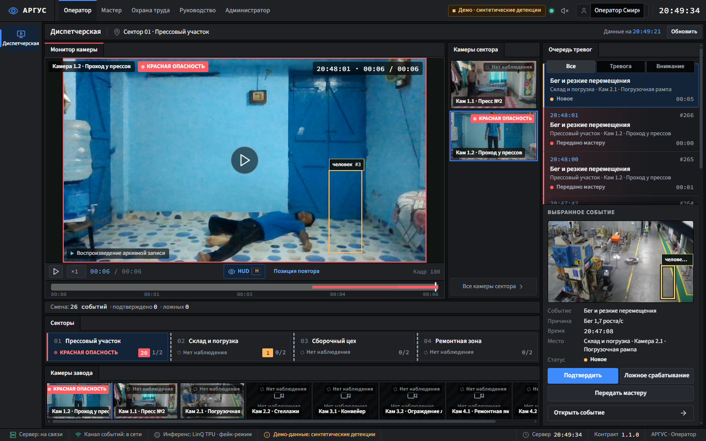
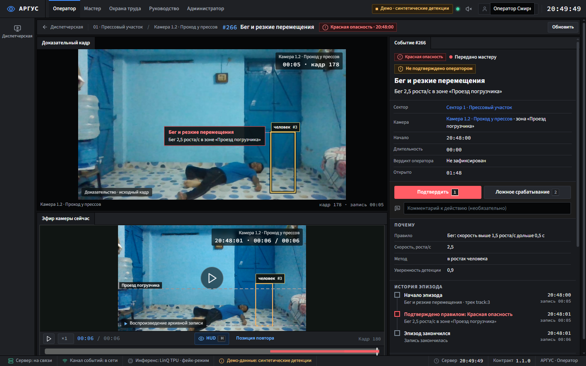
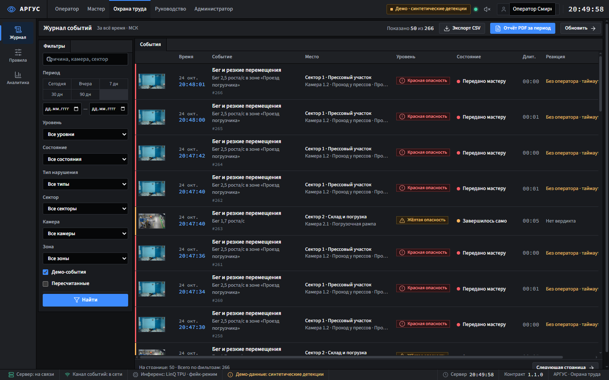
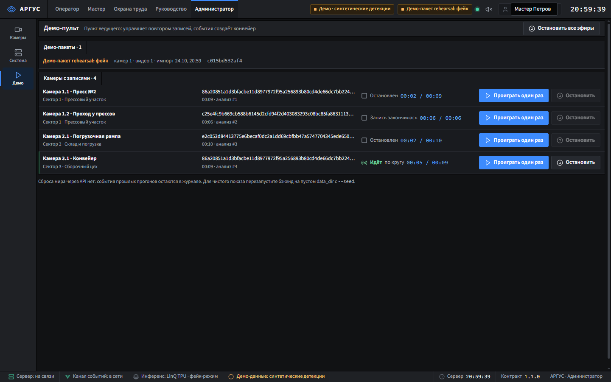
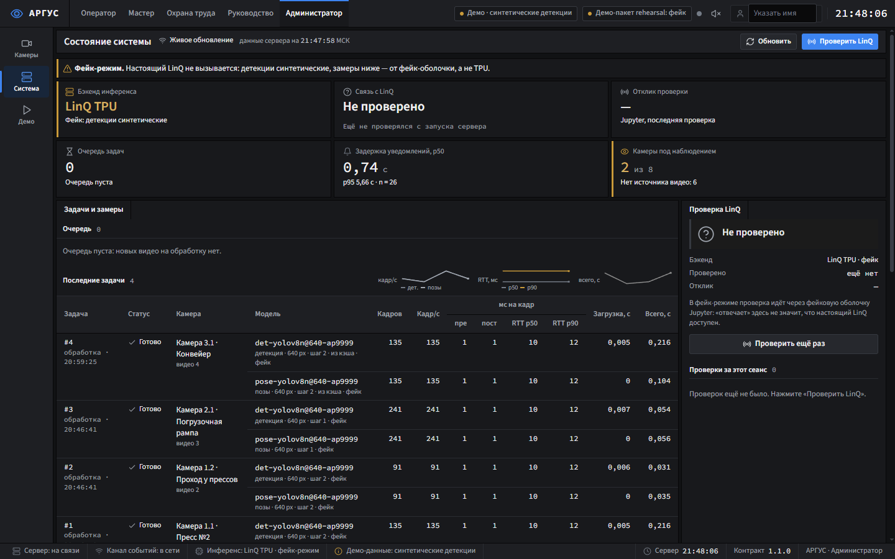
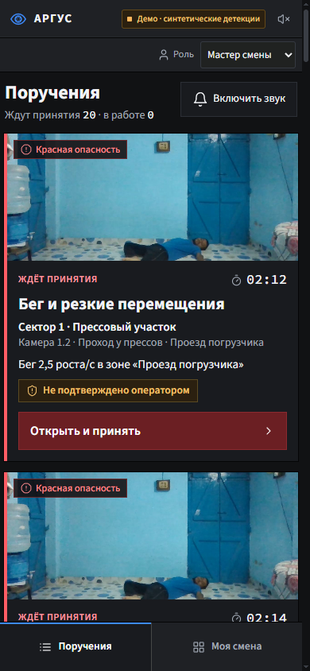

# АРГУС — фронтенд

АРГУС — сервис видеоаналитики промышленной безопасности для кейса LinQ (Открой#Моспром 2026). Он смотрит записи заводских камер, находит опасные ситуации (бег у техники, человек в опасной зоне, падение и неподвижность и др.), поднимает тревогу оператору, передаёт её мастеру смены и ведёт журнал для охраны труда. Детекция людей и поз выполняется на ускорителе LinQ (или на CPU), правила сцены и временная логика — на бэкенде `safewatch`, интерфейс — этот фронт.

Цепочка: запись камеры → детекции на LinQ → треки и эпизоды → правило → одно событие → оповещение → журнал.

## Какую ветку брать

**До слияния PR #21 в `main` лежит старый baseline-фронт.** Клон `main` открывает минимальный интерфейс слайсов (`frontend/src/screens/**`) — это и есть «старая версия». Финальный фронт АРГУС живёт в ветках:

| Ветка | Что в ней | Когда брать |
|---|---|---|
| `main` | бэкенд `safewatch` (актуальный, tech.md v5, контракт 1.1.0) + **старый** фронт | бэкенд для любого запуска |
| `front/final` | **финальный фронт** АРГУС на контракте 1.1.0; бэкенд в ветке — заглушки `NotImplementedError`, его не запускать | фронт, показанный на финале |
| `front/v2-demo` | `front/final` + демо-пульт `/admin/demo`, `npm run demo`, этот README | фронт для показа и сдачи |
| `front/argus-main` | голова PR #21: `main` на 5d940ba2 + фронт `front/final` | после ребейза станет `main` |

Итого до слияния: **бэкенд — из `main`, фронт — из `front/v2-demo` (или `front/final`)**. После слияния PR #21 оба будут в `main`.

## Скриншоты

Сняты на бэкенде `main` в фейк-режиме (`SAFEWATCH_FAKE=1`) с сидом и тремя загруженными роликами. Рамки на кадрах синтетические (фейковые детекции), интерфейс это подписывает: «Демо · синтетические детекции».

| | |
|---|---|
|  |  |
| Оператор: диспетчерская, монитор камеры с HUD, очередь тревог | Карточка события: доказательный кадр, «почему», история эпизода |
|  |  |
| Охрана труда: журнал с фильтрами, CSV, PDF-отчёт | Администратор: демо-пульт |
|  | |
| Администратор: «Система» — бэкенд инференса, замеры, демо-пакеты | |



Мастер смены: поручения на телефоне.

## Запуск

Нужны Node 24 и Python 3.12 с [uv](https://docs.astral.sh/uv/).

### Одной командой: бэкенд в фейк-режиме с сидом + фронт

Один раз положите ветку `main` рядом с репозиторием и поставьте зависимости:

```
git worktree add ../argus-backend origin/main
cd ../argus-backend && uv sync && cd -
cd frontend && npm ci
```

Дальше одна команда из `frontend/`:

```
npm run demo
```

Скрипт `scripts/demo.mjs` запускает в `../argus-backend` `safewatch serve --seed` с `SAFEWATCH_FAKE=1` (порт 8000) и Vite этого фронта с прокси `/api` и `/ws` на бэкенд. Адрес фронта Vite печатает сам (обычно http://127.0.0.1:5173). Ctrl+C останавливает оба процесса.

Переменные:

| Переменная | По умолчанию | Зачем |
|---|---|---|
| `ARGUS_BACKEND_DIR` | `../argus-backend` | своя копия `main` |
| `ARGUS_PORT` | `8000` | порт бэкенда |
| `ARGUS_VIDEOS` | — | папка с mp4 (H.264): перед стартом `safewatch seed --videos` раздаст их камерам сида, бэкенд обработает и сам запустит эфир |
| `UV` | `uv` | путь к uv, если его нет в PATH |

Сид создаёт 4 сектора, 8 камер, зоны и 240 исторических событий за 8 недель. С tech.md v5 (8.19) **демо-события сида не попадают в ленту оператора и в состояния камер и секторов** — они видны только в журнале и аналитике (флажок «Демо-события»). Лента наполняется событиями эфира. **Видео в git нет**: без демо-пакета, `ARGUS_VIDEOS` или загрузки в «Камеры → Настроить → Видео» у камер нет записей, эфиров и, значит, событий в ленте. Пример на Windows (Git Bash):

```
ARGUS_VIDEOS=D:/argus-clips npm run demo
```

Фейк-режиму на чистом клоне не хватает файлов «хвостов» моделей (`models/linq/*_tail.onnx` в git не попадают, а задача проверяет, что файл есть). Скрипт кладёт на их место помеченные заглушки и печатает их список. Фейк их не читает; для настоящего LinQ замените заглушки экспортом по `tools/linq/README.md`.

### Демо-пакет (tech.md 8.19)

Пакет `data/demo/<name>/` — видео и заранее посчитанные детекции. `serve --seed` сам импортирует пакет из `demo.pack` (по умолчанию `data/demo/argus`), задачи берут детекции из пакета (`cached=true`) и не зовут LinQ, эфир идёт по кругу. Так показ не зависит от VPN и LinQ, а детекции настоящие. Пакет в git не попадает: скопируйте папку `data/demo/argus` в копию `main` до `npm run demo`. Собрать свой: `uv run safewatch demo build config/demo.example.yaml --videos data/videos --out data/demo/argus` (на LinQ; на фейке — с `--allow-fake`, пакет помечается как фейк).

Импортированные пакеты (`GET /api/demo/packs`) фронт показывает в шапке, в демо-пульте и на экране «Система»: «Демо-пакет argus: детекции LinQ» или «Демо-пакет <name>: фейк».

### Мок без бэкенда

Примеры контракта (Prism на 4010 + WS-мок на 4011) и Vite в режиме `mock`, одной командой:

```
npm run demo:mock
```

Это проверка экранов на данных из `contract/openapi.json`, сюжета нет. Сценарный мок «жёлтое → красное → мастер → журнал» лежит в ветке `demo/checkpoint`, `tools/checkpoint-demo` (`node src/server.mjs`, те же порты 4010/4011); с ним запускайте `npm run dev:mock`. Кнопки «Следующий шаг» и «Сбросить сценарий» в демо-пульте работают только с этим моком.

### После слияния PR #21

Всё в `main`, фронт раздаёт сам бэкенд:

```
npm ci --prefix frontend && npm run build --prefix frontend
SAFEWATCH_FAKE=1 uv run safewatch serve --seed
```

Открыть http://127.0.0.1:8000.

## Роли

Роль выбирается в шапке («Роль»), логина нет: каждый запрос несёт заголовок `X-Role`, сервер проверяет права по нему.

| Роль | Экраны |
|---|---|
| Оператор | диспетчерская, сектор, камера с HUD и зонами, карточка события, захват экрана при красной тревоге |
| Мастер смены | поручения и смена, вёрстка под телефон |
| Охрана труда | журнал (CSV, PDF-отчёт за период), правила по камерам, аналитика |
| Руководство | аналитика по неделям |
| Администратор | камеры и секторы, настройка камеры (видео, эфир, калибровка, зоны, правила), «Система» (бэкенд инференса, метрики LinQ, демо-пакеты), **«Демо»** |

## Приложение на телефон (PWA)

- `manifest.webmanifest` собирает `vite.config.ts` (плагин `argus-pwa`): имя из `src/brand.ts`, цвета из токенов `ds.css` (`--ds-bg-0` фон, `--ds-bg-2` тема), `display: standalone`. `start_url` — `/m/`: открывает экран сохранённой роли (оператор → `/m/operator`, мастер → `/master`); ярлыки «Оператор» и «Мастер» ведут туда же напрямую.
- Иконки (`public/icons`: 192/512, maskable, apple-touch, бейдж уведомлений) — знак-«глаз» шапки на графите; пересобрать: `node scripts/icons.mjs <путь к пакету playwright>`.
- `public/sw.js` написан руками и регистрируется только в сборке (не в `npm run dev`). Кэширует оболочку: `index.html`, `/assets` текущей сборки, иконки. `/api` и `/ws` не кэшируются никогда. Нет ответа сервера → экран «Нет связи с сервером — данные не показываются» вместо данных.
- Профиль на телефоне: «Установить на телефон» (Chrome, `beforeinstallprompt`), на iOS подсказка «Поделиться → На экран „Домой“»; «Уведомления о тревогах» — разрешение. Системные уведомления идут через `registration.showNotification` (на Android `new Notification()` не работает): оператору — новое красное, мастеру — передача поручения.
- Установка требует HTTPS (или `localhost`): для телефона в цеховой сети фронт нужно отдавать по HTTPS.

## Демо-пульт (`/admin/demo`)

Пункт меню «Демо» у администратора. Подпись на экране: «Пульт ведущего: управляет повтором записей, события создаёт конвейер».

- Демо-пакеты: имя, откуда детекции (LinQ, CPU или фейк), сколько камер и видео, время импорта.
- Список камер, у которых есть записи: запись для эфира (последняя с готовым анализом), состояние эфира и позиция.
- «Проиграть один раз» — `POST /api/cameras/{id}/broadcast` с `{"loop": false, "video_id": <запись>}`: запись проигрывается один раз по часам сервера, события из неё публикует конвейер в момент, когда эпизод «случается» в эфире.
- «Остановить» — `DELETE /api/cameras/{id}/broadcast`; «Остановить все эфиры» — то же для всех камер в эфире.
- Если фронт смотрит на мок (`VITE_API_BASE` на порту 4010): «Следующий шаг» (`POST /__demo/next`) и «Сбросить сценарий» (`POST /__demo/reset`). Там события публикует режиссёр мока по заготовленной истории, это синтетика; пульт так и пишет. У голого Prism режиссёра нет — кнопки неактивны с пояснением.

Сброса мира через API у бэкенда нет: события прошлых прогонов остаются в журнале и ленте. Чистый старт — бэкенд на пустом `data_dir` с `--seed`.

## Сценарий показа (~3 минуты)

Подготовка: `npm run demo` с демо-пакетом (или `ARGUS_VIDEOS`); дождитесь, пока «Администратор → Камеры» покажет записи; в «Демо» проверьте строку пакета и нажмите «Остановить все эфиры» (после обработки бэкенд сам запускает эфир по кругу, и события копятся). В шапке заранее введите имя сотрудника («Указать имя»), иначе первое действие спросит его.

1. **Оператор → Диспетчерская.** Секторы, камеры завода, очередь тревог. Исторические события сида сюда не попадают: в ленте только эфир.
2. **Администратор → Демо → «Проиграть один раз»** на камере с нарушением. Запись идёт как живая камера.
3. **Оператор.** Событие появляется в очереди; красное захватывает экран. «Подтвердить» (клавиша 1) — событие уходит мастеру. Карточка: доказательный кадр с рамкой, «почему» (правило и измерения), история эпизода.
4. **Мастер (телефон или узкое окно).** «Открыть и принять» → «Принял, иду» → «Принятые меры» → «Решено».
5. **Охрана труда → Журнал.** Событие со всей историей и мерами; CSV, PDF-отчёт. **Аналитика** и **Руководство** — тренды по неделям (на сидовых данных, подписано «включая демо-данные»).
6. **Администратор → Система.** Бэкенд инференса, метрики LinQ: кадры/с, RTT; демо-пакеты и откуда их детекции.

Вариант без бэкенда: сценарный мок `demo/checkpoint` + «Следующий шаг» в пульте (1-й раз жёлтое, 2-й — красное).

## Честный статус

**Работает (бэкенд `main` + этот фронт):** загрузка видео, задачи анализа с прогрессом и повтором, треки, эпизоды, правила сцены с зонами и калибровкой (работают 6 сценариев: бег, опасное сближение, телефон, падение и неподвижность, пересечение ограждения, проход под опасной зоной; огонь и курение, привязь, подвешенный груз ждут моделей с нужными классами; переноска груза — заготовка), публикация событий в эфире повтора, захват экрана оператора, эскалация по таймауту, действия оператора и мастера, журнал с фильтрами, CSV и PDF, статистика, webhook-каналы, пересчёт, демо-пакет. Сквозной сценарий и маршруты фронта прогнаны на `main` в фейк-режиме; гейт фронта — `npm run gate`.

**На LinQ:** демо-пакет `argus` — детекции посчитаны на LinQ заранее, шапка подписывает его «детекции LinQ». Детектор YOLOv8n 640 и поза YOLOv8n-pose 640, программы `.tpu` и ONNX-хвосты моделей (`config/models.yaml`). Подтверждённый живой прогон — сборка этого пакета 2026-10-24 (S17): ролик 40 с, 400 кадров; детектор 7,2 кадр/с, RTT p50 495 мс / p90 693 мс; поза 9,0 кадр/с, RTT p50 399 мс. Два ночных прогона (S2, R5) LinQ не ответил: у очереди `input` не было консьюмеров. Модели и демо-пакет в git не лежат. Без LinQ есть `INFERENCE_BACKEND=local` (onnxruntime на CPU, YOLOv8n) — им показан «живой» кусок финала.

**Синтетика:**
- `SAFEWATCH_FAKE=1` — детекции фейковые: рамки и треки сгенерированы, на реальном кадре они не обязаны совпадать с человеком. Интерфейс показывает «Демо · синтетические детекции».
- Сид: 240 исторических событий за 8 недель — на них строятся журнал и аналитика (`is_demo`, фильтр «Демо-события»); в ленту оператора они не попадают.
- Демо-пакет, собранный на фейке (`--allow-fake`), подписан «фейк» в шапке и в пульте.
- Сценарный мок `demo/checkpoint`: события, кадры и рамки заготовлены вручную; на экране подписано «ручная разметка, не детекция модели».
- Видео — повтор загруженной записи по часам сервера («эфир»), не живой RTSP-поток.

**Не сделано во фронте (контракт 1.1.0 уже есть, экранов нет):** м/с и автокалибровка в HUD (8.21, тексты приходят с бэкенда), калькулятор (8.25), датасет ложных срабатываний (8.26), идентификация нарушителя (8.27), паспорт камеры (8.28), PDF сводки смены (8.31). Клип события (8.20), лента оператора с телефона `/m/operator` (8.24) и пакеты на «Системе» (8.19) уже есть. **Не сделано вообще:** живые RTSP-камеры; авторизация (роль — заголовок); Docker одной командой (8.32, S21) на момент ветки не смержен.

## Проверки

```
npm run gate   # api:check, eslint, tsc, vitest, сборка
```
